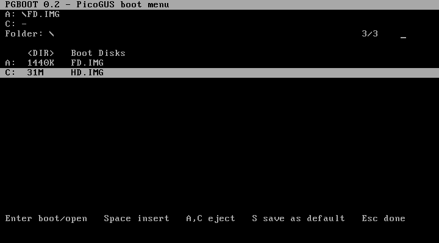

# PGBOOT: boot floppy and hard disk images from the PicoGUS USB drive

**Experimental.** PGBOOT is an 8 KB x86 option ROM. It presents disk image
files on the USB drive plugged into a PicoGUS to the BIOS as a floppy drive
(A:, BIOS drive 00h) and/or a hard disk (C:, BIOS drive 80h), and it can boot
from them. The PicoGUS only decodes I/O ports and cannot carry a ROM itself,
so the ROM goes into an EEPROM on a separate ROM card (the
[Monotech DoubleROM](#monotech-doublerom) is the one it is set up for), or it
is loaded into RAM by `PGBOOT.COM`.

At boot the ROM waits for the PicoGUS and its USB drive, plays a short tune
on the PC speaker if you like, and offers a [boot menu](#the-boot-menu) that
lists the disk images on the drive: pick one and it boots, as a floppy or as
a hard disk.



The card side (`sw/bootdisk/`) serves 512-byte sectors of the image files
over the PGDFS transport. The wire protocol is described in
`sw/bootdisk/PROTOCOL.md` and `sw/dfs/PROTOCOL.md`.

| File | What it is |
|---|---|
| `PGBOOT.ROM` | The option ROM (8192 bytes: `55 AA 10`, init entry at offset 3, checksum byte at the end). For a 28C64, and for writing in the machine. |
| `PGBT256.BIN` | `PGBOOT.ROM` four times (32768 bytes): for a 28C256 written in an EPROM programmer. |
| `PGBOOT88.ROM` | The same code, but it always uses the 8088 transfer loops. This is for testing; on an XT the normal ROM picks those loops by itself. |
| `PGBOOT.COM` | Loader for machines without a ROM board (experimental). |
| `PGFLASH.COM` | Writes the ROM into a 28C64/28C256 EEPROM in the machine (experimental). |
| `test/INT13TST.COM` | INT 13h exerciser used by the tests. It is not needed to boot. |

## Building

You need `nasm` and `python3`. The ROM is developed with NASM 3.02, and
2.16 builds the same bytes.

```
make            # PGBOOT.ROM PGBOOT88.ROM PGBT256.BIN PGBOOT.COM PGFLASH.COM test/INT13TST.COM
make check      # size/header/checksum of both ROMs, and no 186+ opcode outside
                # the two 186+ transfer routines (cpucheck.py on the listing)
```

All sources assemble with `cpu 8086` and with every NASM warning treated as
an error. Only two routines are exceptions: `out186` (`rep outsw`) and
`in186` (`rep insw`). They are assembled with `cpu 186` and only run after the
CPU check has found an 80186 or later. `mkrom.py` pads the image, sets the
checksum byte and verifies it. The header word at 14h holds the number of
bytes in use: about 6.5 KB of the 8 KB.

## Setting up the card

Copy the image files to the USB drive. That is all the boot menu needs: with
the default settings the ROM shows

```
PGBOOT: press M for the boot menu (Esc skips)... 03
```

for three seconds at every boot. The card remembers which images are in
A: and C: (in its settings, like everything `pgusinit` sets), so they can also
be set from DOS:

```
pgusinit /fdimage DOS622.IMG     floppy image -> A: (raw 160K..2.88M, DMF, or any size with a FAT BPB)
pgusinit /hdimage HD\DOS.VHD     hard disk image -> C: (raw with MBR, fixed VHD, superfloppy)
pgusinit /bdopts n               bit 0 floppy read-only, bit 1 hard disk read-only,
                                 bit 2 ROM disabled, bit 3 boot the hard disk even with a floppy image
pgusinit /bdmenu n               boot menu: 0 off, 1 offered at boot with M (default), 2 opens at every boot
pgusinit /bdwait n               seconds the ROM waits for M: 1-15 (default 3)
pgusinit /bdtune n               start-up tune: 0 off, 1-3 (default 1)
pgusinit /save                   make it permanent
pgusinit /fdimage -              remove the floppy image (same for /hdimage)
```

You can change the floppy image while the system is running: the ROM
reports a media change (INT 13h AH=16h) to DOS. A new hard disk image takes
effect at the next boot.

## The boot menu

The menu lists the folder it is in: `..`, the folders, then the disk images,
each group in the order the files have on the drive. A disk image is a file
named `.IMG`, `.IMA`, `.VFD`, `.FLP`, `.DSK`, `.VHD` or `.HDD`. What it is
decides where it goes:

* up to 2.88 MB (and not `.VHD`/`.HDD`): a floppy image, shown as `A:`
* anything larger, and every `.VHD` and `.HDD`: a hard disk image, shown as `C:`

Hidden and system files are left out. An image that the menu sorts into the
wrong kind can still be set with `pgusinit /fdimage` or `/hdimage`.

| Key | What it does |
|---|---|
| Up, Down, PgUp, PgDn, Home, End | move through the list (16 entries a page) |
| Enter | on a folder: open it. On an image: put it in its drive and boot from it |
| Space | put the image in its drive without booting: for a floppy **and** a hard disk at once, such as an installation disk with the hard disk image it installs to |
| A, C | take the image out of A: or C: |
| S | save: the images now in A: and C: become the ones used at every boot (`pgusinit /save` from the menu; it stores all of the card's settings) |
| Esc | leave the menu and boot what is in A: and C:, the floppy first unless option bit 3 says otherwise |

The two lines under the title show what is in A: and C:. A selection that is
not saved lasts until the card is switched off, so the next cold boot uses
the saved images again. The menu passes the images to the card by their 8.3
names (`\BOOTDI~1\DOSBOO~1.IMG`), which is what the boot messages and
`pgusinit` then show; the list itself shows the long names, cut to 27
characters.

The menu needs an 80-column text screen (it switches a 40-column mode to
80x25) and uses only normal and reverse video, so it works on MDA and
Hercules cards too.

## The start-up tune

When the late init has found the card it plays a tune on the PC speaker:
1 is four rising notes (half a second), 2 a short fanfare (a second), 3 a
quick sweep. `pgusinit /bdtune 0` turns it off. A key ends the tune, and the
key still counts (M opens the menu).

## Installing the ROM

### Monotech DoubleROM

The [DoubleROM](https://monotech.fwscart.com/product/doublerom---ide-size-limit-remover---dual-bootable-rom-isa-card)
(Monotech PCs; the design files are at
[github.com/monotech/ISA-DoubleROM](https://github.com/monotech/ISA-DoubleROM))
is an 8-bit ISA card with two DIP-28 sockets for 27C64, 28C64B or 28C256
chips. Each socket has a slide switch for the chip size (`8K` / `256K`) and
a six-way DIP switch. PGBOOT needs one socket. The table below is read from
the published design; the same table is printed on the card, which is the
one to trust if they differ.

| DIP switch | Function |
|---|---|
| 1 | address A16: off = C000h-CFFFh, on = D000h-DFFFh |
| 2 | address A15: on adds 8000h |
| 3 | address A14: on adds 4000h (off for a 32 KB window) |
| 4 | address A13: on adds 2000h (off for a 32 KB window) |
| 5 | ROM enable |
| 6 | write enable (ISA MEMW to the chip): on only while programming |

So the ROM can sit anywhere from C000h to DE00h in 8 KB steps, and the card
never decodes E000h or above. Common choices:

| Segment | 1 | 2 | 3 | 4 |
|---|---|---|---|---|
| C800h | off | on | off | off |
| D000h | on | off | off | off |
| D800h | on | on | off | off |

Which chip, and which file:

| Chip | Size switch | Window | Program it with |
|---|---|---|---|
| 28C64B (8 KB) | 8K | 8 KB | `PGBOOT.ROM`, in the machine or in a programmer |
| 28C256 (32 KB) | 256K | 32 KB at C000h, C800h, D000h or D800h | `PGBOOT.ROM` in the machine, or `PGBT256.BIN` in a programmer |
| 28C256 (32 KB) | 8K | 8 KB: the quarter of the chip that switches 3 and 4 select | `PGBOOT.ROM` in the machine, or `PGBT256.BIN` in a programmer |

`PGBT256.BIN` holds the ROM in each quarter of the chip, so it is right for
every switch setting. Behind a 32 KB window the BIOS finds all four copies;
the first installs and the others see its hook and do nothing. A 28C256
keeps 32 KB of the upper memory area away from EMM386, so the 28C64B is the
better fit.

Programming it in the machine, with the PicoGUS in another slot:

1. Set the address switches, switch 5 (enable) on and switch 6 (write
   enable) on. If the BIOS shadows option ROMs, turn shadowing off for that
   window while programming.
2. Boot DOS without EMM386 or QEMM and write the ROM, with either tool:
   * `PGFLASH D000 PGBOOT.ROM` (the segment you chose; add `/256` for a
     28C256 behind a 32 KB window). See the notes on PGFLASH below.
   * XTIDECFG from the XTIDE Universal BIOS, which Monotech recommends for
     this card: load `PGBOOT.ROM` as the BIOS file, skip "auto configure",
     and flash it to the segment with the EEPROM type of the chip.
3. Switch 6 off again, and reboot.

The other socket can hold an XTIDE Universal BIOS or the HD floppy BIOS as
sold with the card. Read the next section for the order the ROMs must be
in: with an XTIDE BIOS in its default mode, PGBOOT must be at the **higher**
address.

The same steps were not yet run on a real DoubleROM: the ROM, the menu and
the flash tool have been tested in an emulator only.

### On any ROM card (XT-IDE boards with a free socket, ...)

1. Choose a free 8 KB window, for example C800h, D000h, D800h or E000h. It
   must not overlap the VGA BIOS (C000h-C7FFh), a network boot ROM or an
   XTIDE ROM. **Order matters with other disk ROMs.** The BIOS scans option
   ROMs from low to high segments, so each ROM that hooks INT 19h wraps the
   ones scanned before it, and the last one scanned runs first at boot.
   * Some ROMs replace INT 19h without chaining to the old handler: XT
     fixed-disk controller ROMs (the IBM/WD/Xebec family) and the XTIDE
     Universal BIOS in its default mode, which runs its own boot menu.
     PGBOOT must be scanned **after** such a ROM, so give it a higher
     segment. Scanned first, PGBOOT's INT 19h never runs.
   * The XTIDE Universal BIOS configured for late initialisation hooks
     INT 19h and INT 13h at boot time itself. Then both ROMs rearrange the
     drive numbers when their INT 19h runs, and the one that runs second
     sees the other's drives as physical. Use XUB in normal (POST-time)
     mode with PGBOOT above it, or expect the image at 80h to shift.
   * BIOSes with a BIOS Boot Specification boot manager (most 1996+ AT
     BIOSes, "boot device priority" menus) may restore their own INT 19h
     before booting, or boot through their own list without calling
     INT 19h. PGBOOT then never runs its late init. Such machines need a
     BIOS that keeps legacy option ROM INT 19h hooks, or `PGBOOT.COM`.
2. Program the EEPROM. You have three ways to do it:
   * `PGFLASH D000 PGBOOT.ROM` in the target machine. Boot clean first (no
     EMM386 or QEMM) and set the board's write-enable jumper. `/256` sends
     the 28C256 SDP command addresses, but only when the board decodes the
     chip's full 32 KB. `/NOSDP` writes without the unlock sequence. `/BYTE`
     is for chips without page mode. PGFLASH only reads until you confirm.
     It shows what the segment holds now and warns about other option ROMs
     in the same 32 KB window, which a 28C256 or a board decoding 32 KB may
     share. After you confirm, it checks that the segment is not RAM and
     writes. Interrupts stay off from each SDP unlock until the write cycle
     ends. It refuses to overwrite a PGBOOT that is running from that
     segment.
   * XTIDECFG (from the XTIDE Universal BIOS): load `PGBOOT.ROM` as a
     "BIOS image" and flash it to the segment. Skip its "configure" step,
     because that is XTIDE-specific.
   * An external programmer such as the TL866 or T48: write `PGBOOT.ROM` to
     the chip at address 0. On a 28C256 in a board that maps an 8 KB window,
     write it at the offset the board's address jumpers select.
3. Tell memory managers to keep out of the window, for example
   `DEVICE=EMM386.EXE X=D000-D1FF`. The same goes for QEMM, 386MAX and the
   UMB drivers.
4. If the BIOS shadows option ROMs, it may shadow this window too. Shadowing
   is harmless for PGBOOT, which never writes to its own segment. Only
   PGFLASH needs shadowing off for that window.

### Without a ROM card: PGBOOT.COM (experimental)

```
PGBOOT [path\PGBOOT.ROM] [/Y] [/C]
```

`PGBOOT.COM` reads the image (default: `PGBOOT.ROM` in the current directory)
and checks its size, header, signature and checksum. It copies the image to
the top of conventional memory: 40:13h is lowered by 8 KB, so the copy is KB
aligned. It tells the copy where the original BIOS INT 13h handler is, calls
the copy's init entry just as the BIOS would at POST, and then issues
INT 19h. If the ROM does not install (no card, disabled, ...), the loader
puts back the memory and vectors it touched and returns to DOS.

**Run it from a clean boot.** INT 19h does not undo what DOS and TSRs have
hooked. The booted system overwrites DOS in memory while a timer, keyboard
or disk IRQ vector may still point into it. The loader lists such vectors
(08h, 09h, 0Eh, 15h, 1Ch, 70h, 74h, 76h in conventional memory or the HMA)
and asks before it goes on. The fix is a minimal CONFIG.SYS: `STACKS=0,0`
(FreeDOS and MS-DOS hook the IRQ vectors for their stack switcher
otherwise), no TSRs, no HIMEM, no EMM386. The loader refuses to run in
virtual 8086 mode. `/Y` skips the question.

`/C` (catch mode, MS-DOS 3.2 or later only; untested) keeps DOS's own INT 19h
in charge, so that DOS restores the vectors it hooked. The loader points
INT 13h at a boot catcher in the ROM copy, directly and through INT 2Fh
AH=13h. The BIOS's first INT 13h call after DOS's INT 19h then runs the late
init. FreeDOS has no INT 2Fh AH=13h and restores INT 13h on its own, so `/C`
is refused there.

#### Loader <-> ROM convention (header fields)

| Offset | Size | Field |
|---|---|---|
| 06h | 4 | `PGBT` signature |
| 0Ah | 1 | loader interface version, 1 |
| 0Bh | 1 | flags. Bit 0: this image is a writable RAM copy, set by the loader. Bit 1: catch mode active, set by the catcher. |
| 0Ch | 4 | far pointer: the INT 13h handler the ROM chains to. 0:0 means "the vector at INT 19h time". The loader stores the BIOS handler from INT 2Fh AH=13h (ES:BX, else DS:DX, else the current vector). |
| 10h | 4 | previous INT 19h. Written by the init entry only when bit 0 is set. |
| 14h | 2 | bytes used, for information only |
| 16h | 1 | `IRET`. The loader points INT 1Bh (Ctrl-Break) at it. |
| 1Ch | 2 | offset of the boot catcher (`/C`) |

The loader fixes the checksum byte after it patches these fields.

## What happens at boot

1. **POST** (the BIOS far-calls offset 3). If INT 19h already points into
   another copy of this ROM (`PGBT256.BIN` behind a 32 KB window), the ROM
   returns at once. Otherwise it looks for the card with
   these checks: knock CCh on 1D0h; `CMD_MAGIC` = DDh; `CMD_PROTOCOL` >= 5;
   `CMD_DFSMAXLEN` in 512..32768; `CMD_DFSPORT` != 0; `CMD_BDOPTS` with
   bit 7 set, bit 6 clear and bit 2 (ROM disabled) clear. The ROM prints one
   line. If the card is there, it hooks INT 19h and nothing else. If
   nothing answers at all, it still hooks INT 19h: a fast AT POST can reach
   the option ROMs while the card is still booting. The late init then
   gives the card another 2 s and continues with the BIOS boot if it is
   still absent. If the card answers but reports old firmware, PGDFS off
   or the ROM disabled, nothing is hooked. A ROM
   cannot write to itself: an unprotected EEPROM would take the write. So
   the ROM keeps the previous INT 19h in interrupt vector **6Bh** (free
   between POST and boot) until the late init copies it to RAM. A loaded
   copy keeps it in its header instead.
2. **INT 19h (late init).** The ROM checks the card again and takes 1 KB at
   the top of conventional memory (40:13h - 1) for all its state. It then
   runs on its own stack at the top of that block, reads `CMD_BDMENU` and
   plays the tune `CMD_BDTUNE` names. If no image name is configured and
   the boot menu is off (or the firmware has none), it continues with the
   BIOS boot at once. Otherwise it waits for the USB drive: up to 15 s with
   an image configured, 3 s without (`CMD_DFSSTAT` = FFh, BDINFO state 4,
   or an empty BDLIST answering 80h, means "not mounted yet"). A countdown
   is shown and Esc skips the wait (other keys, such as F5/F8 for DOS, stay
   in the keyboard buffer). Then comes the boot menu: opened at once in
   mode 2; in mode 1 after M at the prompt, which counts down the seconds
   of `CMD_BDMENU` (Esc there continues with the BIOS boot, any other key
   ends the wait and stays in the buffer). The menu writes the image names
   to the card; if none is configured after it, the ROM continues with the
   BIOS boot. The
   ROM then sends BDINFO with OPEN for unit 0 (floppy) and unit 1 (hard
   disk), prints a line per configured unit, adjusts the BIOS data area,
   hooks INT 13h and reads sector 0 of the boot image to 0000:7C00. It boots
   the image picked with Enter in the menu; otherwise the floppy image
   first, or the hard disk image when option bit 3 is set or
   there is no floppy image. A hard disk needs 55AAh at the end of the
   sector. A floppy boot sector without the signature is accepted when it
   starts with a jump (EBh/E9h). The ROM then jumps to 0000:7C00 with
   DL = drive, DH = 0, SS:SP = 0000:7C00 and the other registers 0. If the
   first image does not boot, it tries the other one. If neither boots, it
   continues with the BIOS boot, and the images stay installed as A:/C:.
   When no image is ready, the ROM gives the memory back, unhooks INT 19h
   and continues with the BIOS boot.
3. **Running system.** The INT 13h handler serves drives 00h and 80h from the
   card. It passes other drives through to the previous handler, translating
   them as described in the next section.

### Drive mapping

| BIOS drive | Floppy image configured | Hard disk image configured |
|---|---|---|
| 00h | the floppy image (the physical A: is hidden) | physical A: |
| 01h | physical B: | physical B: |
| 80h | physical first disk | the hard disk image |
| 81h..80h+n | physical | physical disk 80h..80h+n-1 (DL-1 to the old handler, DL restored) |

When a floppy image is present, the equipment word (40:10h) is set to report
at least one floppy drive. A hard disk image adds one to 40:75h. INT 13h
AH=08h for 80h or a translated drive returns DL = the number of physical
hard disks the ROM saw at install + 1, taken from its own state rather than
from 40:75h after chaining. AH=15h returns CX:DX unchanged from the old
handler.

### INT 13h functions served

Floppy image (00h): 00 reset (also re-reads the image info), 01 status,
02/03/04 read/write/verify, 05 format (fills the track with F6h, 03h if
read-only), 08 parameters (BL type from the card, ES:DI -> a DPT in RAM with
the image's sectors per track), 15 (AH=02h, change line), 16 (06h + CF once
after the image changed), 17, 18 (0Ch if the requested geometry does not
match the image).

Hard disk image (80h): 00, 01, 02, 03, 04, 08, 09, 0C, 0D, 10, 11, 14,
15 (AH=03h, CX:DX = total sectors), 41h (EDD 1.1, CX=1: 42h-44h, 47h, 48h),
42h/43h/44h (disk address packet, LBA < 2^32, count written back),
47h (bounds check), 48h (1Ah or 1Eh bytes, CHS valid, no DPTE).

Any other function returns AH=01h with CF set. The last status goes to 40:41h
(floppy) or 40:74h (hard disk). CHS addresses outside the geometry, and LBAs
at or past the end of the image, return 04h. Transfers stop at the end of the
image, and AL (or the packet count) holds the number of sectors done. The
buffer (ES:BX or the packet's pointer) is tracked as a linear address. Each
frame gets the segment address/16, but at most FFFFh, so no DMA-boundary
errors are raised. A buffer in the HMA (FFFF:xxxx with A20 on) is served
without wrapping to low memory. A frame that would run past FFFF:FFFF is cut
there, and if not even one sector fits, the ROM returns 09h. Transfers are
split into frames of at most `CMD_DFSMAXLEN`/512 sectors for reads and
(`CMD_DFSMAXLEN`-10)/512 for writes. With the default 4096 that is 8 and 7
sectors. Card status codes pass through as INT 13h status (03h write
protected, 04h, 20h, 80h). A transport timeout or a missing USB drive gives
80h, and a frame the card rejects twice gives 20h.

Every BDREAD/BDWRITE carries the unit's image token from the last BDINFO.
If the floppy image was swapped in between, the card answers 06h. The ROM
passes 06h on (CF set, DOS re-reads the disk), refreshes the unit (new
token and geometry, so the next call works) and also reports the change at
the next AH=16h. For the hard disk, a token mismatch (card rebooted,
different file) is 80h "not ready" until the next boot.

A call that comes in while a request is in progress (an interrupt handler
calling INT 13h during the poll) gets AAh "drive not ready" with CF set, and
the transaction in flight is not disturbed.

### Transport

Every transaction knocks and selects its register again, because another
program may have changed it. On a 186 or later the ROM moves data with
`rep outsw`/`rep insw`. On an 8086/8088 it uses `lodsw/out dx,ax` and
`in ax,dx/stosw` loops, and an odd last byte moves as a single byte. The
CPU test is the shift-count mask, so a NEC V20 counts as an 8088. After
`CMD_DFSEXEC`, the ROM polls `CMD_DFSSTAT`. Reads, verifies and BDINFO get
about 10 s. Writes and BDINFO with OPEN get about 30 s, because the card's
USB write deadline is 10 s per operation and one BDWRITE (write plus sync)
can take several. The time is counted in changes of the BIOS tick count,
and a timeout also needs a minimum number of status reads (ticks x 1.2 x
65536; one ISA read takes at least about 0.7 us). A program that speeds up
the timer therefore cannot shorten the timeout. With interrupts off, twice
that many reads end the wait. On a timeout the ROM aborts the transaction
and returns 80h. An ABORTED status makes it send the request once more, and
NODRIVE returns 80h. Before it starts a request, the ROM reads
`CMD_DFSSTAT`. If another client's request is BUSY (PGDFS interrupted by
an INT 13h call), the ROM waits for it to finish, within the same timeout.

### RAM block (1 KB at segment `[40:13h]*64` after the late init)

| Offset | Content |
|---|---|
| 00h | `PGBT`, old INT 13h, old INT 19h, ROM segment, data port, sectors per read/write frame, CPU flag, installed units, last translated drive, saved 40:10h / 40:75h, options, media-change latch, scratch |
| 30h / 48h | unit structures (floppy, hard disk): cylinders, heads (at most 255), sectors, total, drive type, flags, state, card unit, generation, image token. The geometry is only replaced by a valid BDINFO record, so an ejected floppy keeps its last geometry. |
| 60h | diskette parameter table (AH=08h/18h) |
| 70h | INT 13h trampoline: `push cs / push cs / jmp far ROM:int13_entry`. The INT 13h vector points here. The handler reads its RAM segment from the pushed words and puts the caller's DS back before it returns or chains. |
| 78h-B3h | transaction and transfer parameters |
| C0h-13Fh | BDINFO answer buffer |
| 140h-14Dh | boot menu setting, the image picked to boot from, the menu's page and selection |
| 14Eh-1C1h | folder shown in the boot menu |
| up to 400h | stack for the late init (the INT 13h handler runs on the caller's stack, about 50 bytes) |

Everything up to 13Fh is where version 0.1 had it. While the boot menu is open, the kilobyte below the block holds the page of
the folder listing (16 entries of 48 bytes). That memory is free until the
boot sector has been loaded, and the ROM does not keep it.

If INT 19h runs again (a reboot through INT 19h), the ROM finds its block
through the INT 13h vector, undoes the previous installation and reuses the
block.

## Expected screen output

No card (or firmware without PGDFS/PGBOOT):
```
PGBOOT 0.2: PicoGUS not found, will look again at boot   [then at INT 19h: PGBOOT: PicoGUS not found]
PGBOOT 0.2: PicoGUS firmware without PGBOOT support
PGBOOT 0.2: PGDFS disabled or unsupported on the card
PGBOOT 0.2: disabled (pgusinit /bdopts bit 2)
```
Card found, floppy and hard disk image, the stick mounts a few seconds late:
```
PGBOOT 0.2: PicoGUS found, data port 1D4h (186+)       [(8088) on an XT, (8088 forced) for PGBOOT88.ROM]
PGBOOT: waiting for the USB drive (Esc skips)... 12    [only while not mounted; counts down from 15, or from 3 with no image configured]
PGBOOT: press M for the boot menu (Esc skips)... 03    [menu mode 1; the screen is cleared when the menu closes]
PGBOOT: A: \FD.IMG, 1440K
PGBOOT: C: \HD.IMG, 31M                                [" (read-only)" appended when read-only]
PGBOOT: booting A:
```
Other late-init lines, each followed by the normal BIOS boot:
```
PGBOOT: no disk image configured
PGBOOT: skipped                                        (Esc)
PGBOOT: no USB drive                                   (the wait ran out)
PGBOOT: A: \MISSING.IMG - file not found               (also: - unusable image, - no USB drive,
                                                        - too fragmented (copy it to a freshly formatted drive), - not ready)
PGBOOT: no image ready
PGBOOT: C: card error 80h
PGBOOT: C: boot sector read error 04h
PGBOOT: C: not bootable (no 55AAh signature)
PGBOOT: continuing with the BIOS boot
```

## Tests

`tools/emu/run-tests.sh` (QEMU with the pgbridge device and the card
simulator) covers these cases:
* T1: FreeDOS floppy image, with a write.
* T2: T1 with `PGBOOT88.ROM`.
* T3: `FDISK /MBR` and `SYS C:` onto a blank hard disk image through the ROM.
* T4: boot that hard disk image.
* T5: USB drive mounted 3 s late.
* T6: no card.
* T7-T11: missing image, boot order, floppy swap from DOS, PGDFS next to
  the ROM, another data port.
* T12-T14, T16: the boot menu, driven with keystrokes: browse into a folder
  and boot an image there, insert a floppy image and boot a hard disk image,
  save, eject, Esc; M and Esc at the prompt.
* T15: the start-up tune (the speaker gate is traced) and the prompt
  running out with nothing configured.
* T17: the ROM four times in the option ROM area, as a 28C256 with
  `PGBT256.BIN` shows it behind a 32 KB window.
* T18: `pgusinit /bdmenu /bdwait /bdtune`.

`tools/emu/README.md` has the full list.

`test/INT13TST.COM [W]` prints AH=08h/15h for 00h/80h/81h. It also tests
EDD 41h/48h, compares CHS against LBA reads over several frames, reads into
an odd unnormalised buffer, checks error codes, reads a physical 81h through
the translation, and with `W` does write/readback/restore on A: and the last
LBA of 80h. The last line is `INT13TST DONE, n failures`.

## Limitations

* Every sector goes through the USB drive and FatFs on the card. The ROM
  waits for each write until the card has synced the file, so disk-heavy
  work is slower than on a real disk.
* SMARTDRV and other write-behind caches hold writes in RAM. Turn write-behind
  off for the image drives (`SMARTDRV C-` or `/X`), or flush before a power
  cycle, or the image can end up inconsistent.
* Windows 9x runs these drives in MS-DOS compatibility mode (real-mode
  INT 13h, no 32-bit disk access), which is slow but works. Windows 3.x
  32-bit disk access (WDCTRL) does not apply: keep 32BitDiskAccess off.
* The ROM and PGDFS (the PGDFS redirector) share the card's single
  transport. Both knock and select for every transaction, so they coexist as
  long as neither is called from an interrupt handler while the other is in
  the middle of a transaction. A disk cache that flushes from the timer
  interrupt could do exactly that.
* An image that is in use must not be changed through PGDFS. The card
  refuses to modify, rename or delete an open image file (access denied),
  but other files on the stick are fine.
* The hard disk image must fit the CHS view for old DOS: at most 1024
  cylinders, 256 heads, 63 sectors. Larger images are reachable through
  EDD (LBA) only.
* No INT 41h/46h fixed disk parameter table is installed for the image.
  Software that reads the geometry from there instead of INT 13h AH=08h sees
  the physical disk.
* The pre-POST INT 19h is kept in vector 6Bh between POST and the late init
  (ROM only). If another ROM uses that vector at POST, change `OLD19_VEC`
  in `defs.inc` and rebuild.
* `PGBOOT.COM` depends on a clean boot, and its `/C` mode is untested on
  MS-DOS.
* A floppy image that was ejected (`/fdimage -`) still answers AH=08h with
  the last geometry. Reads return 80h.
* PGFLASH is untested on real EEPROMs. Its refusal paths (RAM,
  read-only window, running ROM) have been checked in QEMU.
* The boot menu shows at most 65535 entries of a folder, in the order they
  have on the drive (not sorted), and follows folders up to a path of 114
  characters. It needs a card frame of at least 1 KB (`CMD_DFSMAXLEN`; the
  default is 4 KB) and is left out below that.
* With the default settings every boot waits three seconds for M. `pgusinit
  /bdmenu 0` (and `/save`) takes the prompt away; `/bdwait` shortens it.
* The tune and the countdowns are timed by the BIOS timer tick, which must
  be running when the BIOS issues INT 19h.
