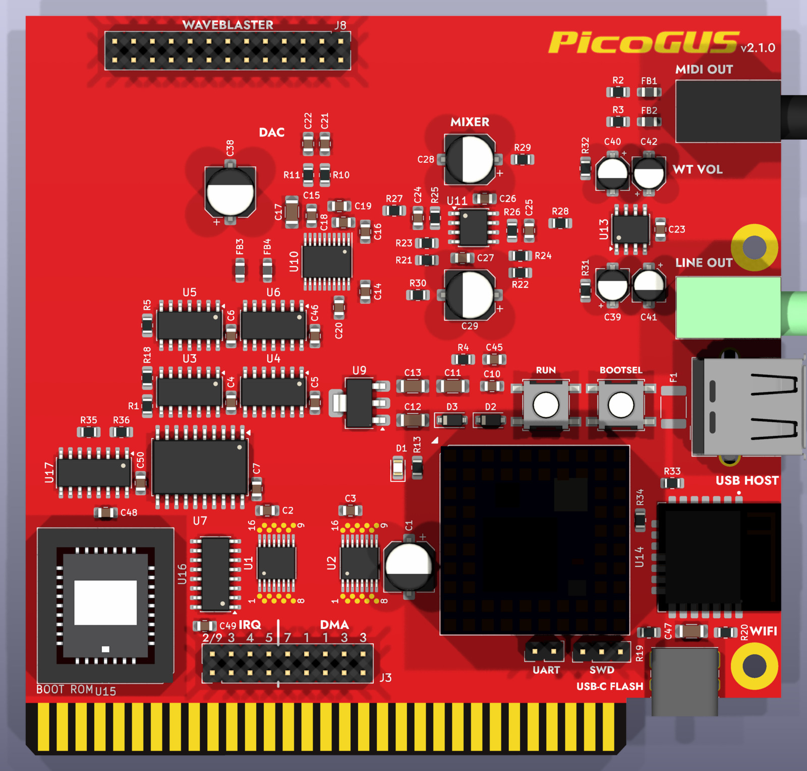

# PicoGUS SMD v2.1 – the THT v2.1 card with surface-mount parts

The SMD counterpart of [PicoGUS THT v2.1](../hw-tht-v2.1/README.md), in the way [`hw-smd`](../hw-smd/README.md) is the
SMD counterpart of THT v1.3. It is **the same circuit with the same reference designators and the same nets**, so the
THT v2.1 README describes how it works and the same firmware runs on it (`core2350.uf2`, and `pg-ne2k-v21.uf2` with
the radio module). Only the packages change.

* Same card: the 102.0 × 99.95 mm outline, the bracket-side connectors and tab holes of THT v2.1, 4 layers.
* **Same Core2350B arrangement**: the Waveshare Core2350B2 module on four 2x8 sockets, same footprint and same place.
* **Parts picked for soldering by hand**: 0805 resistors and capacitors on KiCad's hand-solder lands (longer pads),
  SOIC (1.27 mm pitch) wherever the chip exists as SOIC, and everything on the front. Nothing is on the back.
* The radio module (U14) and the experimental boot ROM (U15–U17) of THT v2.1 are included, and optional as there.
  The boot ROM's flash sits in a surface-mount socket, the one part here that is not easy by hand: see
  [Boot ROM socket](#boot-rom-socket).

> **Status: draft for placement review. The schematic is done; the board has every part placed and labelled but is
> NOT routed. Not built, not tested.**
> Schematic: ERC gives the same messages as THT v2.1, and its netlist is identical to THT v2.1's (201 nets, 589 pins,
> 102 parts; only footprints, values and part numbers differ). Board: 0 courtyard overlaps, 0 schematic parity
> issues, 401 connections still to route. The BOM has part numbers but no prices: see [BOM](#bom).
> The board is not in the Hardware workflow yet, because an unrouted board fails its DRC.

| File | What |
|---|---|
| `PicoGUS-SMD.kicad_pro/.kicad_sch/.kicad_pcb/.kicad_dru` | KiCad **10** project. The board is the THT v2.1 board (outline, stackup, plane zones, logo, edge connector, connectors and modules in place) with the SMD parts placed and no tracks |
| `audio.kicad_sch`, `mixer.kicad_sch`, `bootrom.kicad_sch` | The DAC, line-out mixer and boot ROM sheets of THT v2.1 with SMD footprints |
| `PicoGUS-SMD-schematic.pdf` | Schematic PDF |
| `docs/BOM-SMD.csv` | BOM with part numbers, no prices yet: see [BOM](#bom) |
| `docs/renders/` | Render of the placement |
| `tools/gen_tssop20_handsolder.py`, `tools/gen_plcc32_smd_socket.py` | Write the two footprints this board adds to the shared library (`hw-common/PiGUS library.pretty`): the TSSOP-20 with hand-solder toes and no test pads, and the surface-mount PLCC-32 socket with its 3D model |

## What changed from THT v2.1

| Part | THT v2.1 | SMD v2.1 |
|---|---|---|
| U3 74AHC14, U4/U5 74AHC00, U6 74AHCT126 | DIP-14 | SOIC-14 |
| U7 74AHC244 | DIP-20 | SOIC-20 wide |
| U11 NE5532 | DIP-8 | SOIC-8 |
| U9 MCP1826S 3.3 V regulator | TO-220, lying | SOT-223 |
| U16 74HCT138, U17 74HCT153 (boot ROM) | TSSOP-16 on the back | SOIC-16 on the front |
| U15 flash socket (boot ROM) | through-hole PLCC-32 socket | surface-mount PLCC-32 socket; the chip can also be soldered to the same lands |
| U10 PCM5100A | TSSOP-20 with hand-solder toes and a test pad per pin | the same toes, no test pads |
| Resistors | axial; four 0805 on the back | 0805 on the front; 0.1 % thin film in the audio path (R10, R11, R21–R26), 1 % thick film elsewhere |
| Capacitors up to 2.2 µF | radial ceramic | 0805: X7R, and C0G for the DAC filter (C21, C22) and the mixer feedback (C24, C25) |
| 10 µF (C11–C13, C17, C47) | radial ceramic | 1206 |
| 47 µF and 100 µF (C1, C28, C29, C38) | radial electrolytic | SMD can, 6.3 mm |
| C39–C42, 2.2 µF Waveblaster coupling | film | bipolar SMD electrolytic, 4 mm can (as `hw-smd` does for the same job) |
| FB1–FB4 | axial ferrite | 0805 ferrite bead |
| D2, D3 | 1N5819, DO-41 | B5819W, SOD-123 |
| D1 | 3 mm LED | 0805 LED |
| F1 | radial PTC | 1812 PTC |
| SW1, SW2 | 6 mm through-hole button | 6 mm SMD button |

Unchanged: U1/U2 (SN74CB3T3257) exist only as TSSOP and keep THT v2.1's footprint with hand-solder toes and a test
pad per pin; U13 (M62429L) is a SOIC-8 already. All connectors and headers stay through hole, as do the module
sockets. The radio module keeps its hand-solder lands.

## Placement

The connectors, the module, the DAC, the mixer and the power parts are where THT v2.1 has them. The logic and the
boot ROM are grouped differently, because the small packages allow it:

* **ISA logic** (U3, U4, U5, U6 and U7): a 2 × 2 block of the SOIC-14s in the centre of the card, between the DAC and
  the bus switches, with U7 below it. On THT v2.1 the DIPs fill a column down the left edge, far from the edge
  connector pins, the jumper block and the module they connect. Measured as the straight-line length of the
  connections of these five chips (shortest tree per net, supplies left out):

  | Arrangement | Length | |
  |---|---|---|
  | Column on the left, as on THT v2.1 | 1773 mm | |
  | The same column with the chips in another order or turned 180° | 1766 mm at best | turning or reordering gains nothing |
  | The column closed up at its lower end (capacitors beside the chips) | 1690 mm | −5 % |
  | **Block in the centre (this placement)** | **1455 mm** | **−18 %** |

  For all signal nets of the card that is 4621 mm before and 4367 mm now. Each chip is turned so that its supply
  pin is at the bottom right, and its 0.1 µF capacitor stands right of it at that pin; that orientation costs 38 mm
  against the best one. The pull-ups and the pull-down (R5, R18, R1) stand left of the block. The left third of the
  card under the Waveblaster header is empty now.
* **Boot ROM**, bottom left: the flash socket where THT v2.1 has it, the address select U17 above it and the decoder
  U16 right of it.
* **Power**: the regulator U9 with its input and output capacitors against its pins, then the two supply diodes in a
  row that ends at the module's supply pin.
* **DAC**: see [DAC capacitors](#dac-capacitors). The AVDD bulk capacitor C38 is next to the bead that feeds AVDD
  (on THT v2.1 it is beside the mixer).
* **Mixer**: the feedback resistor and capacitor of each channel beside the op-amp pins they connect, the input
  resistors below them, the ±12 V filters above and below.
* **Waveblaster volume**: U13 is turned a quarter so both channels face the mixer, and all four coupling capacitors
  are at the chip. On THT v2.1 the two input capacitors are more than 30 mm away, near the header, which leaves a
  long high-impedance track. The input pull-downs R31/R32 moved here with them.
* The analogue parts stay inside THT v2.1's AGND and AVDD plane islands, which are unchanged; the logic block is
  outside them.

Neighbouring parts have at least 0.55 mm between their pads. Every part has its reference on the silkscreen beside
it: 0.8 mm text, 1.0 mm for the chips. The exceptions have no reference: the two buttons, which carry `RUN` and
`BOOTSEL`, J2 and J4 (`SWD`, `UART`), the edge connector and the mounting holes. The silkscreen check finds no new
overlap: what it reports, the divider line at J3 and U12's corner mark on its pin 1, is on THT v2.1 as well.

### DAC capacitors

With a test pad per pin, as on THT v2.1, the capacitors of U10 stood 2.3 to 5.3 mm from their pins, beyond the test
pads. Here U10 is on the same hand-solder toes without the test pads, and the capacitors are placed in the order in
which they matter:

| Capacitor | Pin of U10 | Where | Pad to pad |
|---|---|---|---|
| C18, charge pump flying capacitor | 2 and 4 (CAPP, CAPM) | across the two pins, straight above them | 0.7 mm each (was 2.3 and 4.7) |
| C16, charge pump supply | 1 (CPVDD) | at pin 1's corner of the package | 1.3 mm (was 4.8) |
| C15, analogue supply | 8 (AVDD) | straight above the pin, with the 10 µF C17 beside it | 0.7 mm (was 5.3) |
| C19, negative rail | 5 (VNEG) | behind C18 | 2.9 mm (was 2.3) |
| C20, internal regulator | 18 (LDOO) | straight below the pin | 0.7 mm (was 2.5) |
| C14, digital supply | 20 (DVDD) | at pin 20's corner | 1.3 mm (was 2.5) |

Pins 1 to 5 are 0.65 mm apart and an 0805 is 2 mm wide, so not every capacitor can be at its pin: the flying
capacitor and the supplies come first, and C19 sits one row out. The two outputs (pins 6 and 7) leave between C15
and C18 to their filter (R10/C21, R11/C22) 6 mm away; they are not sensitive to that length. The ground pins (3, 9
and the strapped pins) are meant to go to vias under the package when the board is routed, because the capacitor
pads cover the space above them.

### Boot ROM socket

U15 is the footprint of a surface-mount PLCC-32 socket without locating pegs: Amphenol FCI 69802-432LF or -132LF,
Assmann A-CCS 032-Z-SM, Mill-Max 940-44-032-17-400000 (rows 11.02 and 13.56 mm apart by their drawings, pads
0.76 × 1.91 mm; Preci-Dip's 540 series is narrower and does not fit). Two things to know:

* **It is not a hand-soldering part.** On every one of these sockets the solder tails turn inwards under the
  housing, 2 to 3 mm inside its outer wall. That takes hot air or reflow, or a fine tip through the open frame
  before the chip goes in. The through-hole socket of THT v2.1 is the easy one by hand; it can come back if that
  matters more than having no holes there.
* **The flash can be soldered straight to the same lands** (its own lands lie inside the socket's pads), which is
  easy by hand. Then it has to be programmed first: the card cannot write it.

The housing is about as large as the through-hole socket's (up to 18.2 × 20.8 mm) and 4.5 mm high. What the board
gains is that the 32 holes are gone: tracks can pass under the socket on the other layers.

## BOM

`docs/BOM-SMD.csv` lists every part with manufacturer part number and DigiKey number. The column **Part number**
says where each line comes from:

* `as on THT v2.1` (17 lines): the same part as on the through-hole board, taken from its BOM.
* `hw-smd BOM (2026-09-29)` (21 lines): the part and its DigiKey number come from the checked BOM of `hw-smd`.
* `checked 2026-11-24` (12 lines): the parts that are new here, looked up on DigiKey's product page and, where the
  land pattern or the pin-out depends on it, in the manufacturer's datasheet. The Notes column says what was read.
* `checked 2026-11-27` (1 line): the surface-mount socket of the boot ROM, from the makers' drawings.

Stock and prices were not looked at for any line, and there are no cart upload files yet: they come when the board
is routed.

Three things from the check that are easy to get wrong when ordering:

* **C38** is EEE-FK1E101**X**P (6.3 mm can). EEE-FK1E101P without the X is 8 mm and does not fit.
* **C39–C42** are UWP1**V**2R2MCL1GB (35 V, 4 mm can). The 50 V UWP1H2R2MCL1GB is 5 mm and does not fit. They are
  bipolar and fit either way round; the + mark on the board comes with KiCad's footprint and means nothing here.
* **U9**: the SOT-223 MCP1826S has the same pin order as the TO-220 of THT v2.1 (VIN, GND, VOUT, tab on GND).
  DigiKey sells MCP1826S-3302E/DB only in tubes; the BOM names the taped MCP1826ST-3302E/DB.

## Next

1. Review of the placement.
2. Routing (4 layers, 0.2 mm tracks and clearances; the boot ROM corner should not need THT v2.1's 0.15 mm any more),
   DRC, then the Hardware workflow entry and JLCPCB files.
3. Prices, DigiKey and LCSC upload files.
