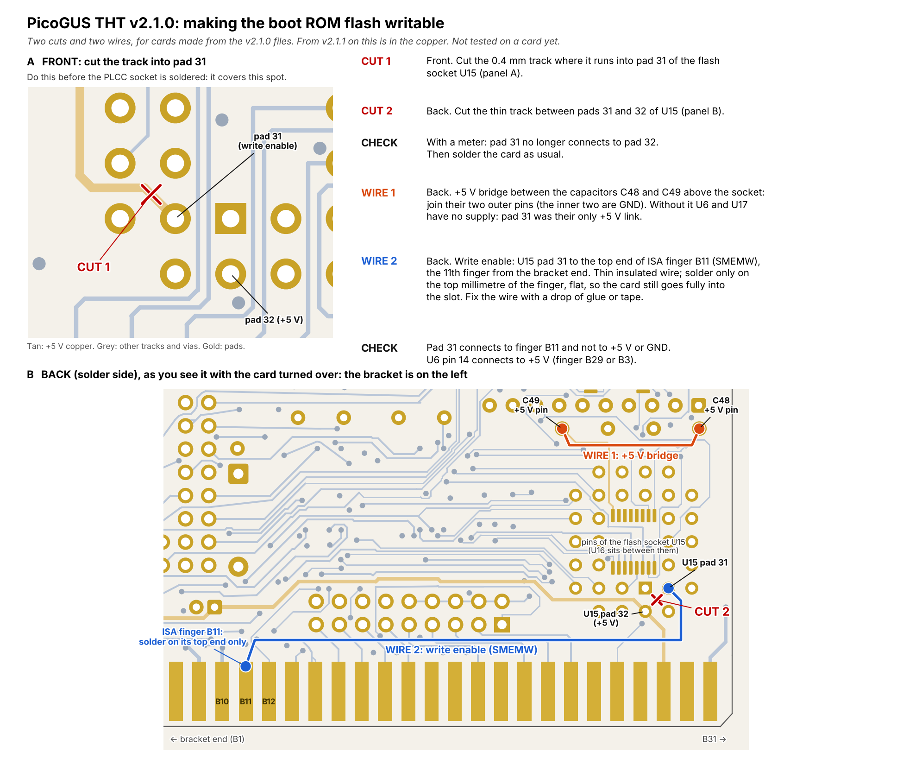

# THT v2.1.0: making the boot ROM flash writable

On cards made from the **v2.1.0** files the boot ROM flash (U15) is read-only: its write enable (pin 31) is tied to
+5 V, and ISA's memory write strobe SMEMW (edge connector pin B11) is not connected. From **v2.1.1** on the two are
joined in the copper. This page shows how to do the same on a v2.1.0 card with two cuts and two wires.

**Not tested on a card yet.** The cards without the boot ROM parts do not need it.

## Why two wires

Pad 31 of the socket is more than the write enable's +5 V: on v2.1.0 the +5 V supply of U6, U17, C46, C48 and C50
reaches them **through that pad**. Once the pad is cut free, that part of the card has no supply, so wire 1 gives
it back.

## Steps

Do the cuts on the bare board, before the PLCC socket is soldered: the socket covers cut 1.

1. **Cut 1, front.** The 0.4 mm track that comes from the left edge of the card and runs into pad 31 of U15: cut it
   close to the pad. Nothing else is within 1.5 mm on that side.
2. **Cut 2, back.** The thin (0.3 mm) track between pad 31 and pad 32 of U15.
3. **Check** with a meter that pad 31 no longer connects to pad 32, then assemble the card as usual.
4. **Wire 1, back: +5 V bridge.** C48 and C49 stand side by side above the socket. Join their two **outer** pins
   (both +5 V; the two inner pins are GND). About 15 mm of insulated wire, laid round the inner pins.
5. **Wire 2, back: write enable.** From pad 31 of U15 to the **top end** of edge connector finger **B11**, the 11th
   finger from the bracket end on the back (B10 beside it is GND, B12 is SMEMR). About 50 mm of thin insulated wire
   (wire-wrap or enamelled wire). Solder only on the top millimetre of the finger and keep the joint flat, so the
   card still goes fully into the slot; no solder on the rest of the finger. Fix the wire with a drop of glue or
   tape.
6. **Check**: pad 31 connects to finger B11, and to neither +5 V nor GND. Pin 14 of U6 connects to +5 V (fingers
   B3 and B29).

If the socket is already soldered, cut 1 cannot be reached. Cut the same +5 V track where it leaves C48's +5 V
pin towards the socket instead (on the front, between that pin and the socket; lift C48 for it). Everything else is
the same; the track under the socket then belongs to the write enable.

## Writing the flash

With the ROM switched on (`pgusinit /bootrom d000`, or `c800`, `d800`), the flash appears as a 32 KB window that
DOS programs can write:

* XTIDECFG from the XTIDE Universal BIOS project, r620 or later: Flash EEPROM, EEPROM type "SST39SFx flash".
* Lo-tech's FLASH utility: `flash image-file base-address`.

Both were read in their sources, not run on this card. The flash only accepts a write after a three-byte unlock
sequence (SST39SF010A datasheet, DS20005022), so ordinary memory writes into the window do nothing. Switch ROM
shadowing off for the window in the PC's setup, or the PC writes to its copy in RAM instead of the chip.

If a written image stops the PC during its start-up, pull the chip, or: hold BOOTSEL while the PC starts, so the
module waits in its USB loader and the pull-ups R35/R36 keep the ROM switched off. When DOS is up, press RUN: the
firmware starts and switches the ROM on again, and a good image can be written. This follows from the schematic
and the firmware source and has not been tried.
